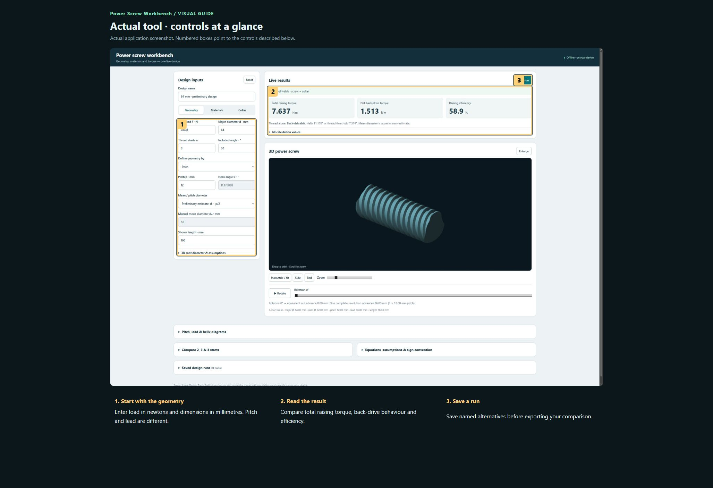
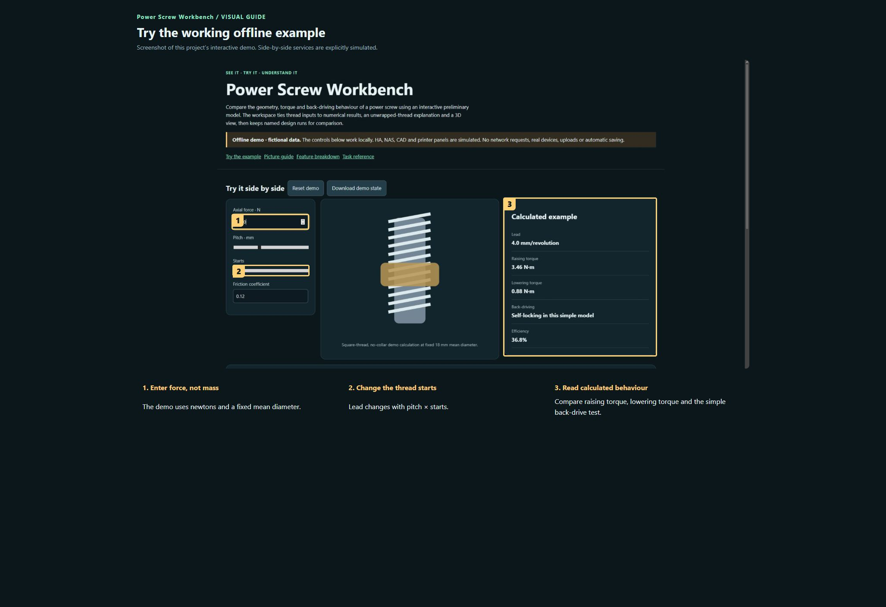

# Power Screw Workbench

Compare the geometry, torque and back-driving behaviour of a power screw using an interactive preliminary model. The workspace ties thread inputs to numerical results, an unwrapped-thread explanation and a 3D view, then keeps named design runs for comparison.

**Private preview · not published.**

[Open the visual manual](docs/USER-MANUAL.md) · [Download the self-contained demo](demo.html) · [Release notes](CHANGELOG.md)

Download `demo.html` using GitHub’s Download raw file control, then open it in your browser. GitHub displays HTML source; it does not run the demo on this page. The demo is an offline simulation with fictional data and makes no network requests.

## See it

### Actual tool · controls at a glance

Actual application screenshot. Numbered boxes point to the controls described below. 

1. **Start with the geometry.** Enter load in newtons and dimensions in millimetres. Pitch and lead are different.
2. **Read the result.** Compare total raising torque, back-drive behaviour and efficiency.
3. **Save a run.** Save named alternatives before exporting your comparison.

### Try the working offline example

Screenshot of this project’s interactive demo. Side-by-side services are explicitly simulated.

1. **Enter force, not mass.** The demo uses newtons and a fixed mean diameter.
2. **Change the thread starts.** Lead changes with pitch × starts.
3. **Read calculated behaviour.** Compare raising torque, lowering torque and the simple back-drive test.

## What this tool does

| Feature | What it lets you do | Where |
| --- | --- | --- |
| Geometry | Load, major diameter, starts, thread angle, pitch or helix angle, and mean-diameter basis. | Browser-local |
| Materials and friction | Screw/nut material, manufacturing process, lubrication and supplier/measured friction override. | Browser-local |
| Collar model | Optional collar friction and mean collar diameter. | Browser-local |
| Live results | Raising torque, back-drive/lowering behaviour, efficiency and disclosed assumptions. | Browser-local |
| 3D and diagrams | Orbit, zoom, side/end views, rotation and equivalent nut advance; compare thread starts. | Browser-local |
| Saved runs | Named comparisons and Excel XML, Excel-compatible and JSON exports. | Browser-local |

## A first useful workflow

### Define a meaningful case

1. Give the run a name, then enter axial force in N and dimensions in mm. Do not enter mass where a force is requested.
2. Select Pitch or Helix angle as the independent input. Check thread starts: lead is starts multiplied by pitch, so one turn can advance more than one pitch.
3. Use a measured/supplier mean diameter when available instead of silently treating the preliminary estimate as a standard thread specification.

## Saving and outputs

Runs and current settings are stored on this device’s browser. Export JSON before clearing site data or changing computers. Spreadsheet exports are for review; JSON is the explicit restore format.

## Running the actual tool

Serve locally and open projects-host/site/power-screw/index.html.

The demo has no prerequisites; the real tool may need the services described in the manual and retained source notes.

## Current boundaries

This is a preliminary geometry/friction model. It does not replace checking buckling, fatigue, thread strength, lubrication variation and the actual assembly. No new engineering validation was performed during documentation work.

## Licence and sharing

MIT applies to original project contributions. Bundled/upstream software and assets retain their own terms; see [third-party notes](THIRD-PARTY.md). Keep this repository private until its own [release checklist](RELEASE-CHECKLIST.md) is complete and the owner authorises publication.
